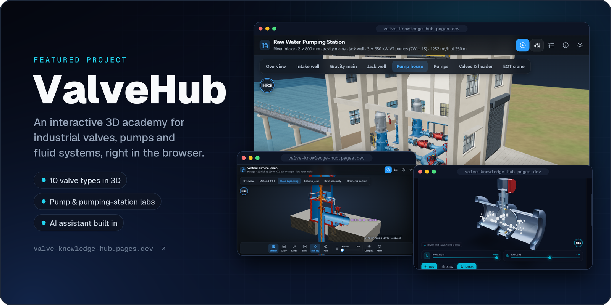

  

### 👋 About me

I build **interactive 3D experiences for the web**, mostly with React, Next.js and Three.js.
Right now I'm working on **[ValveHub](https://valve-knowledge-hub.pages.dev)**, a free 3D academy where you can open up industrial valves and pumps right in the browser.

- 🧊 &nbsp;**3D on the web:** React Three Fiber and WebGL, with section cuts, exploded views and X-ray modes
- ⚙️ &nbsp;**Engineering, made visual:** valves, pumps and fluid flow you can spin, slice and explore
- 🎞️ &nbsp;**Motion & UI:** Framer Motion, Tailwind CSS and clean design systems
- 🌱 &nbsp;**Exploring:** custom shaders and real-time flow simulation

### 🧰 Tech stack

  

### 🚀 Featured project

 

**What's inside:**

- 🔩 &nbsp;**3D Explorer:** 10 valve types you can cut away, explode and inspect part by part
- 🏭 &nbsp;**Equipment Lab:** a 9-stage vertical turbine pump, a working pumping station and a walkable intake site
- 📚 &nbsp;**Academy:** 4 modules covering valve mechanics, Cv/Kv, sizing and diagnostics, plus an animation sandbox
- 🧮 &nbsp;**Tools:** a live flow simulator and a valve comparison matrix
- 🤖 &nbsp;**Ask AI:** a built-in assistant on Cloudflare Workers AI for valve and pump questions

  
  &nbsp;
  

### 🧪 Also on my bench

**[Valve Experience Platform](https://github.com/harsh-hrs/Valve-experience-platform):** the first React + Three.js prototype that grew into ValveHub. It has a valve catalog with clickable parts, an exploded view and an operating animation.

 

  

